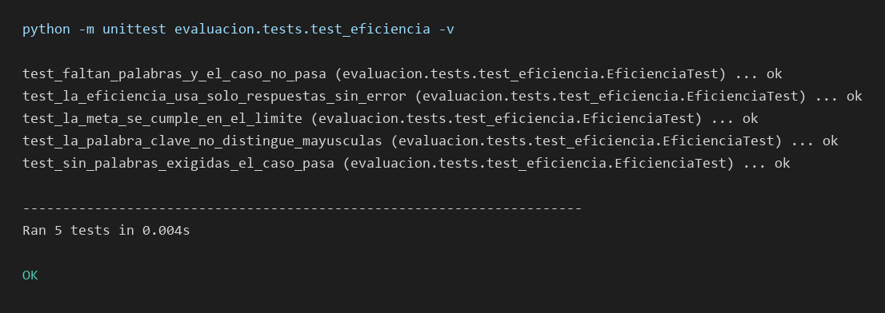

# Chat de soporte NexoStock (RAG local)

Chat de soporte del MVP de NexoStock. Responde con la base de conocimiento del proyecto: productos, inventario, ventas, roles y reportes. No consulta la base de datos y no inventa existencias, precios ni usuarios.

Open WebUI queda en http://localhost:8080. El puerto 3000 lo usa el API Gateway de NexoStock.

## Código

La medición vive en `evaluacion/`, separada del chat:

- `dominio`: el caso, el resultado y la regla de eficiencia.
- `puertos.py`: contratos del generador, el juez, el dataset y la bitácora.
- `aplicacion`: el caso de uso, que solo ordena esas piezas.
- `infraestructura`: Open WebUI, el `.env` y los archivos jsonl.
- `evaluate_rag.py`: arma las piezas y arranca.

## Requisitos

- Docker Desktop en ejecución, con al menos 8 GB asignados a la máquina virtual.
- Python 3.10 o superior.

## 1. Levantar Ollama y Open WebUI

En esta carpeta:

```powershell
docker compose up -d
docker exec ollama-nexostock ollama pull qwen2.5:7b-instruct
```

La primera descarga del modelo tarda. La interfaz abre en http://localhost:8080. El primer usuario que se registre queda como administrador.

## 2. Crear el modelo `nexostock-soporte`

1. En Documents o Knowledge, crear la colección `NexoStock soporte`.
2. Subir los seis archivos de `conocimiento/`.
3. El corte es 500 tokens y el solapamiento 50. Esos valores ya van en `docker-compose.yml` (`CHUNK_SIZE` y `CHUNK_OVERLAP`). Si la colección se creó antes de levantar ese compose, hay que reprocesar los archivos.
4. Crear un modelo. Nombre visible: `NexoStock soporte`. ID: `nexostock-soporte`.
5. Modelo base: `qwen2.5:7b-instruct`.
6. Copiar el texto de `modelo/system_prompt.md` en el system prompt.
7. Adjuntar la colección `NexoStock soporte` y guardar.
8. En Ajustes, Cuenta, crear una API key.

## 3. Ejecutar las pruebas

La regla de eficiencia se comprueba sin levantar el modelo:

```powershell
python -m unittest evaluacion.tests.test_eficiencia
```

Las 50 preguntas del dataset sí necesitan Open WebUI:

```powershell
python -m venv .venv
.\.venv\Scripts\Activate.ps1
pip install -r requirements.txt
copy .env.example .env
```

Editar `.env` y pegar la API key en `OPENWEBUI_API_KEY`. Ese archivo se queda en la máquina.

```powershell
python evaluate_rag.py
```

El script guarda latencia, errores y palabras clave en `runs/`. La meta es al menos 70% de casos con las palabras clave esperadas. Si queda por debajo, se ajusta el prompt o el dataset y se repite con otro `RUN_TAG` en `.env`.

Al terminar, guarda la captura de esa consola en `evidencias/resumen-50-pruebas.png`. En Open WebUI guarda la ficha del modelo en `evidencias/modelo-nexostock-soporte.png` y una respuesta del chat en `evidencias/respuesta-chat.png`. Esas tres imágenes quedan en la sección Evidencias.

Para sumar el juez de fidelidad (1 a 5) con el mismo modelo:

```powershell
$env:JUDGE_MODEL="qwen2.5:7b-instruct"
python evaluate_rag.py
```

## 4. Regenerar el informe

```powershell
python informe/generar_informe.py
```

Eso actualiza `Informe-modelo-rag-nexostock.pdf` con el porcentaje de la última corrida.

## Documentos de la base

- `conocimiento/01-producto-y-roles.md`
- `conocimiento/02-productos-y-categorias.md`
- `conocimiento/03-inventario.md`
- `conocimiento/04-ventas.md`
- `conocimiento/05-reportes.md`
- `conocimiento/06-arquitectura.md`

Los parámetros del corte, el modelo y la evaluación están en `modelo/parametros.md`.

## Evidencias

Las capturas viven en `evidencias/` y se muestran aquí.

### Pruebas unitarias

Cinco pruebas de la regla de eficiencia. No usan Open WebUI ni el modelo.



### Las 50 preguntas, el modelo y el chat

Estas tres se agregan al cerrar la corrida en el equipo donde corre `qwen2.5:7b-instruct`:

- `evidencias/resumen-50-pruebas.png`: consola de `python evaluate_rag.py`, con latencia y el porcentaje.
- `evidencias/modelo-nexostock-soporte.png`: ficha del modelo y la colección en Open WebUI.
- `evidencias/respuesta-chat.png`: una respuesta del chat de soporte.
